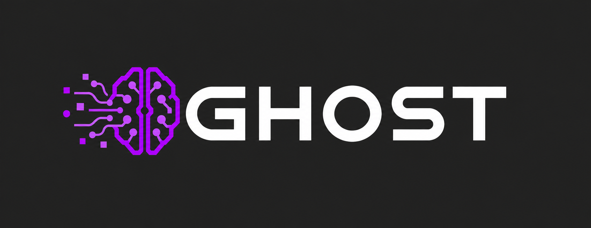

# GHOST


This project was developed entirely with AI assistance.

GHOST is a reusable engineering cognition layer derived from the public
technical writing and gists of Nikkeyl, plus the supplied `AI Engineering
Skills - Neural Blueprint.md`.

The name is a codename, not a claim that an agent can reproduce a human
engineer's complete judgment. The system encodes repeatable constraints,
diagnostics, procedures, and mental models while keeping engineering decisions
with the human and the evidence.

## Model

```text
Rules       = always constrain relevant decisions
Heuristics  = context-sensitive defaults
Passive     = notice material risk during another task
Active      = execute a complete engineering procedure
Knowledge   = reusable facts and mental models
```

The source material was translated into this model rather than copied
literally. A fixed component layout is useful as a consistency convention; it
is not a universal React law. A safe-change protocol is useful as a workflow;
it must not force a user-confirmation deadlock or unsafe automatic commits.

## Progressive activation

Use the smallest relevant set:

```text
all capabilities → relevant candidates → 2–5 active skills → verified result
                                  ↘ lightweight passive checks
```

Default graph constraints are five active skills and two traversal levels.
Increase them only when the task is genuinely cross-cutting and state why.
The default router is `understand-and-plan-change`: it selects a parent skill
from the candidate families, keeps leaf procedures grouped, and expands only
when investigation exposes a material uncovered risk.

Runtime-specific loading and context-budget guidance lives in
`.agents/knowledge/runtime-adapters-and-context-budget.md`; it is read on
demand and is not part of the always-loaded core.

## Imported workflow capabilities

The scoped `info-for-ghost` import adds review, test strategy, behavior-preserving
refactoring, migration planning, API research, change handover, Markdown
authoring, and requested lesson capture. It also adds lightweight signals for
weak test evidence, overmocking, abstraction leaks, complexity, and build impact.
Select these through the skill index; the activation budget remains unchanged.

Requirements, plan, manual-test, migration, handover, verification, and skill
evaluation templates live in `.agents/templates/`. Read them only when the
task needs a persistent artifact, using the adopting project's destination.

The source map, accepted scope, adaptation decisions, and validation limits
are recorded in [`docs/info-for-ghost-import.md`](./docs/info-for-ghost-import.md).
Optional authoring preferences are documented in
[`.agents/knowledge/personal-authoring-preferences.md`](./.agents/knowledge/personal-authoring-preferences.md);
enable that profile explicitly rather than treating it as a team-wide rule.

## Repository layout

- `.agents/` — portable rules, knowledge, active skills, and passive detectors.
- `docs/` — blueprint, source analysis, roadmap, and the candidate backlog.
- `AGENTS.md` and `CLAUDE.md` — compact runtime discovery adapters kept in the
  repository root so supported agents can find the portable core.

## Entry points

- Start with `AGENTS.md`.
- Use `.agents/rules/00-operating-principles.md` and
  `.agents/rules/10-reasoning-and-evidence.md` for every engineering task.
- For a code change, route through `understand-and-plan-change`,
  `implement-minimal-change`, and `verify-change` as needed.
- Load `review-component-anatomy` only for React component work.
- Load `review-custom-control` when a custom interactive control or its state
  matrix is in scope.
- Load `review-form-contract` when a form or its submission lifecycle is in
  scope.
- Load `review-metadata-strategy` when page metadata, indexability, localized
  URL relationships, social previews, or structured data are in scope.
- Let passive detectors raise signals; do not turn every warning into a full
  audit.

See [`docs/GHOST-ANALYSIS.md`](./docs/GHOST-ANALYSIS.md) for the source
inventory, evidence quality, and decisions that were deliberately not
promoted to unconditional rules.

The long-term capability backlog and implementation sequence are tracked in
[`docs/ROADMAP.md`](./docs/ROADMAP.md). It intentionally groups the 444
candidate procedures into domain families before promoting individual
procedures to standalone skills.

## License

[MIT](./LICENSE)
